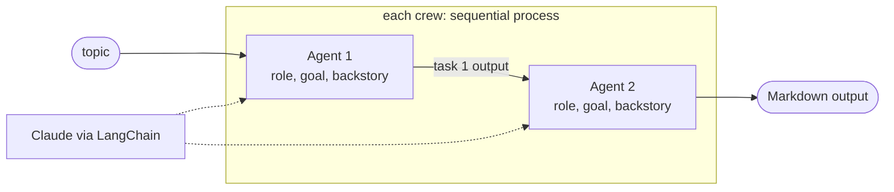

# CrewAI + Claude Multi-Agent Workflows

**Three two-agent pipelines built with CrewAI and Claude: research into a blog post, a startup idea into an investor pitch, and a Seoul itinerary into a bilingual (English and Korean) travel blog.**

[](https://colab.research.google.com/github/dojedaro/crewai-claude-multiagent-workflows/blob/main/crewai_claude_multiagent_workflows.ipynb)
[](https://github.com/dojedaro/crewai-claude-multiagent-workflows/actions/workflows/notebooks.yml)

## The three crews

| Crew | Agent 1 → | Agent 2 | Output in the saved run |
|---|---|---|---|
| Research to blog | AI Researcher: real-world uses of AI in education | Article Writer: 150-word post | "How AI is Transforming Education Today", citing tutoring systems such as MATHia |
| Idea to pitch | Startup Ideator: problem, users, solution for an EdTech idea | Pitch Writer: one investor paragraph | *MentorMatch*, an AI platform matching students with industry mentors |
| Trip to bilingual blog | Seoul Itinerary Planner: 3-day budget trip | Bilingual Travel Blogger: English + Korean summary | "Seoul Steal: A Budget-Friendly Solo Trip to Korea's Capital" |

## How it works



Each crew has two specialized **agents** (role, goal, backstory, and the shared Claude LLM) and two
**tasks** with an expected output. CrewAI runs the tasks in order and passes the first task's output
to the second agent as context. Splitting "gather" from "write" keeps each prompt short and lets
each agent be instructed for one job.

## Run it

```bash
pip install -r requirements.txt
export ANTHROPIC_API_KEY=...
jupyter notebook crewai_claude_multiagent_workflows.ipynb
```

The notebook uses `claude-3-opus-20240229`, which Anthropic has retired, through LangChain's
deprecated `langchain.chat_models` import. To run it today, switch to
`from langchain_anthropic import ChatAnthropic` and a current model such as `claude-sonnet-5-5`.

## Stack

Python, CrewAI, LangChain (Anthropic integration), Claude.

## Limitations and next steps

- **No grounding.** The researcher agent has no search tool, so "research" is the model's memory;
  facts such as named products should be verified or sourced. A web-search tool plus citation
  checks fixes this ([factcheck-agents](https://github.com/dojedaro/factcheck-agents) does it
  without a framework).
- **No comparison with one prompt.** Whether two agents beat a single well-written prompt was never
  measured; for tasks this small, they may not.
- Structured outputs (a Pydantic model per task) would make the hand-off between agents checkable.

## License

MIT
